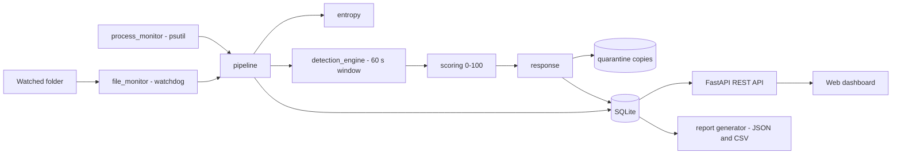

# RDRS: Ransomware Detection and Response System

A defensive, educational tool that watches a folder for ransomware-like behaviour
(many files rewritten with random-looking data and renamed), scores the threat from
0 to 100, and responds automatically. **It never runs real malware and never kills a
process: simulation mode is on by default.**

## How it works

| Signal | Fires when (in 60 s) | Weight |
|---|---|---|
| rapid_encryption | 20+ different files modified | 40 |
| mass_rename | 15+ files renamed or extension changed | 30 |
| high_entropy | average entropy 7.0+ over 5+ files | 25 |
| cpu_spike | a process above 80% CPU | 15 |

Score 40+ is a **Warning**, 70+ is **Critical**. A Critical alert opens an incident,
**copies** the affected files to `data/quarantine/incident_N/` (originals are never
touched or deleted) and logs which process would be terminated.

## Setup (Windows, Python 3.12)
    python -m venv .venv
    .venv\Scripts\activate
    pip install -r requirements.txt

## Run
    python -m app.main --watch ./data/sandbox        # the monitor
    uvicorn app.api.server:app --port 8001            # API + dashboard: http://127.0.0.1:8001
    python scripts/simulate_ransomware.py             # safe attack simulator (creates new files only)
    python -m app.reports.generator                   # report for the newest incident

## Test
    pytest --cov=app --cov-report=term-missing

## Docker
    docker compose up --build        # dashboard: http://localhost:8000
    docker compose exec monitor python scripts/simulate_ransomware.py

> Note: the Docker files are provided, but I could not run Docker on my machine, so they are untested.

## API
`GET /health, /status, /alerts, /events, /incidents, /scores, /reports, /settings`,
`POST /scan, /settings`. Interactive docs: `/docs`.

## Project layout
    app/core         config, logging, entropy, data model
    app/detectors    file monitor, process monitor, detection engine, scoring, response
    app/database     SQLite storage
    app/api          REST API (service.py = logic, server.py = routes)
    app/dashboard    single-page dashboard
    app/reports      incident report generator
    app/pipeline.py  connects everything
    scripts/         safe ransomware simulator
    tests/           automated tests
    docs/            screenshots and sample logs

## Known limitations
- Evidence is copied at the moment of detection, so files hit a moment later are not included.
- The suspect process is the busiest real process: a hint, not proof.
- Real process termination is deliberately not implemented.
- The API has no login; run it on localhost only.